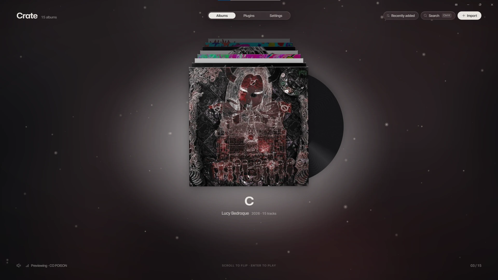
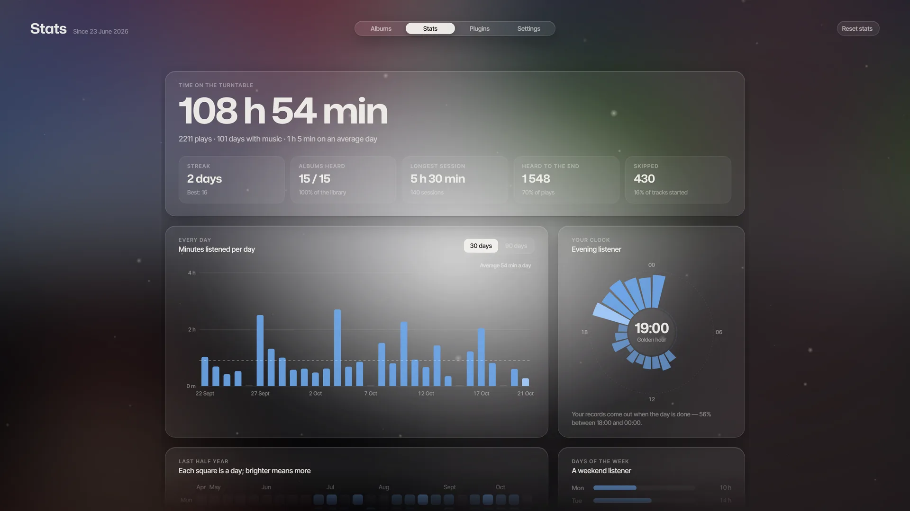
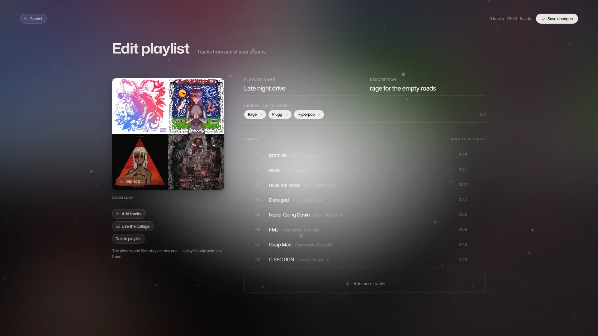
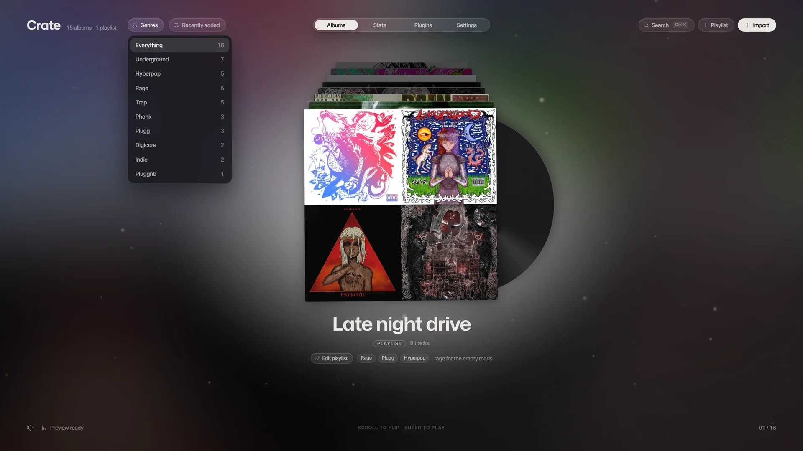
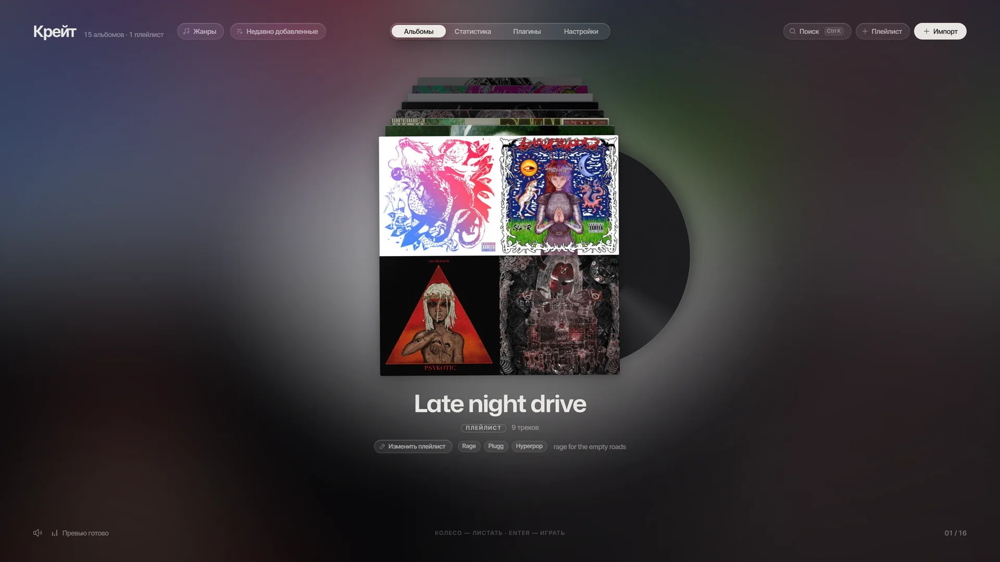
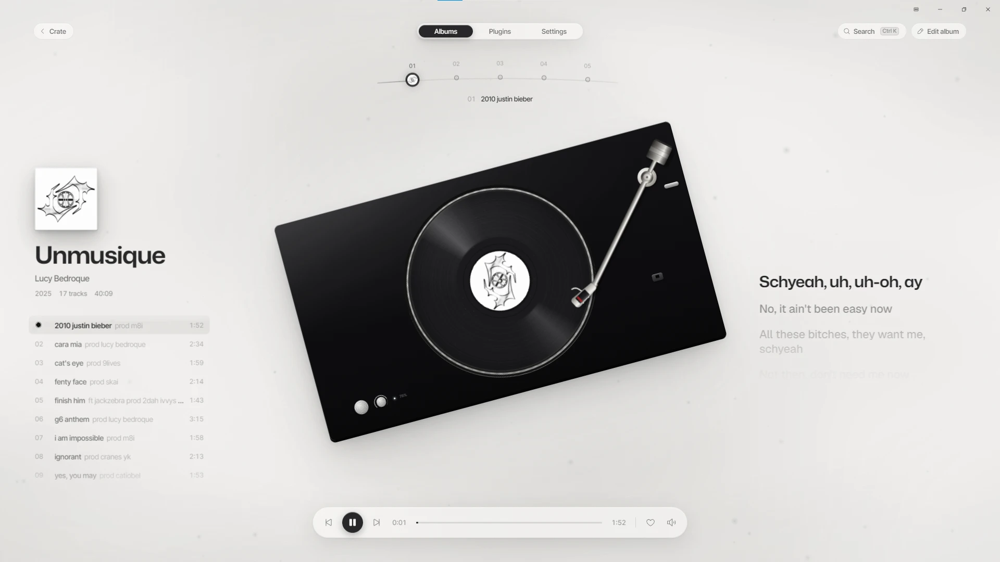
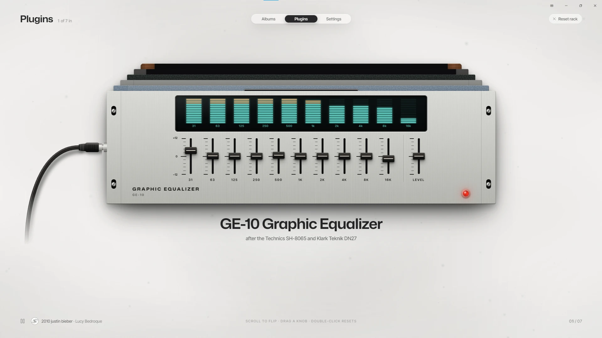
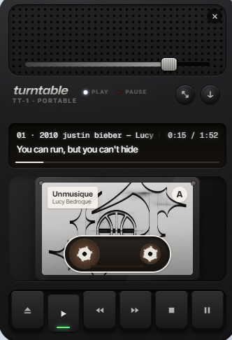
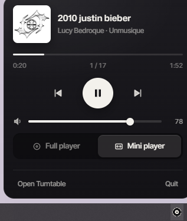

# Turntable

**A tactile player for your own music.** Your albums sit in a crate, the record spins on a turntable, lyrics scroll in time with the song, and when you need it out of the way the whole thing folds into a pocket cassette recorder.

🇷🇺 [Русская версия ниже](#turntable-по-русски)

- **Crate & turntable** – flip through your albums, drop the needle, drag the tonearm to wind to any moment, hold the platter to scratch.
- **Synced lyrics** – found automatically on [LRCLIB](https://lrclib.net) and kept on your computer, so they work offline. Or drop an `.lrc` next to a track.
- **Plugin rack** – seven studio-style units between the record and the volume: two equalizers, a leveling amp, a valve clipper, a sampler crusher, a lowpass filter and a tape echo.
- **Download** – paste a soundcloud.com link (a track, an album or a playlist) into **Download** and it is fetched with yt-dlp and pressed into your crate as a record. No account, no keys, no server. The **Downloads** screen shows the queue, and *Add to album / playlist* on the deck adds a single track straight into the one you have open.
- **Playlists** – build them from tracks of your albums or from any audio files on your computer; a collage cover is made for you. Albums stay as they are, a playlist only points at them; files you add are copied into Turntable's folder.
- **Genres** – up to three tags per album or playlist, a genre filter in the crate and genre search, with plenty of underground ones (rage, plugg, phonk, digicore, hyperpop and more).
- **Stats** – time on the turntable, minutes per day, your listening clock, a half-year heatmap, top albums and tracks, streaks and a few little facts.
- **Shuffle & loop** – in an album shuffle stays inside it; in the mini player and the tray it can be off, album-only or across all albums.
- **Mini player & tray** – `Ctrl+M` folds the app into an always-on-top, resizable cassette recorder. A tray menu and global keys keep it within reach with the window hidden.
- **Search** – `Ctrl+K` finds albums, artists and tracks, even with the wrong keyboard layout or a typo.
- **Make it yours** – turntable and record colours, the mini player's body, display and cassette, dust in the air, start with Windows.
- **English and Russian** – the whole interface, switchable in Settings.
- **Any common format** – mp3, m4a, flac, wav, ogg and opus; what the webview can't play is decoded by a built-in native decoder.















<p align="center">
  
  &nbsp;&nbsp;
  
</p>

Windows 10/11, x64. Your files are copied into the app's own folder, so moving the originals later changes nothing.

## Download and install

1. Open the **[Releases](../../releases)** page of this repository and download **`Turntable-Setup-0.1.3.exe`** from *Assets*.
2. Run it. Windows may say *"Windows protected your PC"* because the installer is not code-signed yet: click **More info → Run anyway**.
3. Press **Install** (**Update** if an older version is already installed, **Reinstall** if it is the current one). The setup finishes in a few seconds; keep *Open when done* ticked and Turntable starts by itself. The setup speaks English and Russian: the **RU / EN** switch is in its top-right corner (it starts in your system language).

Turntable installs for the current user (no admin rights) into `%LOCALAPPDATA%\Turntable`. Your library lives in `%APPDATA%\app.turntable.player`.

## Using it

**Add music.** In the crate press **Import** (or `Ctrl+I`), or drag a folder or files onto the crate window. `mp3`, `flac`, `m4a`, `wav`, `ogg` and `opus` work. Title, artist and cover are taken from the tags and from a `cover.jpg` / `folder.jpg` in the folder; fix anything by hand, drag the handle to reorder, click a title to rename, then **Save album**.

**Play.** Scroll or use `←` `→` to flip through the crate (a few seconds of a random track play as a preview), click the sleeve or press `Enter`, then click the record (or press `Enter`) to drop the needle.

| Key | What it does |
|---|---|
| `Space` | play / pause |
| `←` `→` | previous / next track (on the crate: flip albums) |
| `Esc` | back to the crate |
| `Ctrl+K` or `/` | search the library |
| `Ctrl+I` | import an album |
| `Ctrl+M` | mini player on / off |
| `F11` | full screen / window |

Global keys (work with the window hidden, rebindable in *Settings → Keys*): media keys, and `Right Alt` + arrows – `←` `→` change the track, `↑` `↓` change the volume.

The first launch shows a welcome screen and a quick guide; both can be opened again in *Settings → About*.

## Build from source

The source code is in [`source/`](source).

Requirements: Windows, [Node.js](https://nodejs.org) 20+, [pnpm](https://pnpm.io), [Rust](https://rustup.rs) (stable, MSVC toolchain) and the WebView2 runtime (already on Windows 11).

```powershell
cd source
pnpm install

pnpm dev                    # the UI alone in a browser at http://127.0.0.1:1420 (demo albums)
pnpm tauri dev              # the real app with hot reload
pnpm tauri build            # app + NSIS installer -> src-tauri/target/release/bundle/nsis
pwsh installer/build.ps1    # the branded setup -> release/Turntable-Setup-<version>.exe
```

Downloads from SoundCloud work out of the box: Turntable fetches yt-dlp once into its own folder, no keys needed.

Stack: [Tauri 2](https://tauri.app) (Rust) · React 19 · TypeScript · Vite · zustand · GSAP · Web Audio · music-metadata.

```
source/
├─ src/               React app: screens, audio engine, plugin rack, mini player
├─ src-tauri/         Rust backend: library, tray, global keys, window, installer config
├─ installer/         the branded setup (its own small Tauri app + UI)
├─ design-reference/  tokens, fonts and the deck artwork the UI is built on
└─ public/            static assets served as-is
```

## License

[MIT](LICENSE) © 2026 reinessant. Fonts, libraries and other bundled parts keep their own licences: see [THIRD_PARTY_NOTICES.md](THIRD_PARTY_NOTICES.md).

## Bugs and ideas

Turntable is young and made by one person. If something breaks, looks off, or you are missing a feature, write to me – every message gets read:

- News and updates: [t.me/turntabletg](https://t.me/turntabletg)
- Telegram: [@openwoundsdotcom](https://t.me/openwoundsdotcom)
- Discord: `reinessant`

## Committing (guide for AI assistants and contributors)

The repository root holds the docs; all code lives in [`source/`](source). Releases are published from here.

1. **Check first.** In `source/` run `pnpm build` (type-check + Vite build). After Rust changes also `cargo check` in `source/src-tauri`. Don't commit a tree that doesn't build.
2. **Version.** For a user-visible change bump the patch version in all five places: `source/package.json`, `source/src-tauri/tauri.conf.json`, `source/src-tauri/Cargo.toml`, `source/installer/src-tauri/Cargo.toml`, `source/installer/src-tauri/tauri.conf.json`. Update the installer file name in *Download and install* above.
3. **Stage deliberately.** `git status` first, then `git add` the files you mean. Never commit `target/`, `node_modules/`, `dist/`, `release/`, `*.exe`, `*.pdb`, `.env.local`, videos or other big binaries (nothing over a few MB without a reason). Keep screenshots small (WebP, 1920×1080).
4. **One logical change per commit.** Message in English, imperative mood, a short subject (up to ~70 characters) and a body listing what changed and why when it isn't obvious: `Add playlist editor`, `Fix hiss while paused`, `Bump version to 0.1.3`.
5. **Don't rewrite history.** Plain `git push origin main`. No `--force`, no rebasing pushed commits. Only push when the owner asks.
6. **Releases.** Build the installer with `pwsh source/installer/build.ps1`, then attach `Turntable-Setup-<version>.exe` (and a source zip) to a GitHub Release tagged `v<version>`. The `.exe` is never committed.
7. **Report.** Say what changed, the new version, the commit hash and whether it was pushed.
---

# Turntable (по-русски)

**Тактильный плеер для вашей собственной музыки.** Альбомы лежат в крейте, пластинка крутится на проигрывателе, тексты песен идут синхронно со звуком, а когда нужно не мешать, всё складывается в карманный кассетник.

- **Крейт и проигрыватель** – листайте альбомы, опускайте иглу, перематывайте перетаскиванием тонарма, придерживайте пластинку и скретчите.
- **Синхронные тексты** – находятся сами на [LRCLIB](https://lrclib.net) и сохраняются на компьютере, поэтому работают и без интернета. Либо положите `.lrc` рядом с треком.
- **Рэк плагинов** – семь студийных приборов между пластинкой и громкостью: два эквалайзера, компрессор, ламповый клиппер, сэмплер-краш, фильтр и ленточное эхо.
- **Плейлисты** – собираются из треков ваших альбомов или из любых аудиофайлов с компьютера, обложка-коллаж делается сама. Альбомы остаются как есть, плейлист только ссылается на них; добавленные файлы копируются в папку Turntable.
- **Жанры** – до трёх тегов на альбом или плейлист, фильтр в крейте и поиск по жанрам, много андеграунда (rage, plugg, phonk, digicore, hyperpop и другие).
- **Скачивание** – вставьте ссылку soundcloud.com (трек, альбом или плейлист) в **Скачать**: Turntable загрузит её через yt-dlp и вложит в ящик пластинкой. Без аккаунта, ключей и сервера. Очередь видна на экране **Загрузки**, а *Добавить в альбом / плейлист* на деке кладёт один трек прямо в открытый.
- **Статистика** – время на проигрывателе, минуты по дням, ваши часы прослушивания, тепловая карта за полгода, топ альбомов и треков, серии дней.
- **Шафл и луп** – в альбоме шафл остаётся внутри него; в мини-плеере и трее можно выбрать: выкл, альбом или все альбомы.
- **Русский и английский** – весь интерфейс, переключается в настройках.
- **Мини-плеер и трей** – `Ctrl+M` складывает приложение в кассетник поверх всех окон, его размер можно менять. Меню в трее и глобальные клавиши управляют музыкой, пока окно спрятано.
- **Поиск** – `Ctrl+K` ищет альбомы, исполнителей и треки, даже в неправильной раскладке и с опечатками.
- **Настройте под себя** – цвета проигрывателя и пластинки, корпус, дисплей и кассета мини-плеера, пыль в воздухе, запуск вместе с Windows.

Windows 10/11, x64. Файлы копируются в собственную папку приложения, так что оригиналы потом можно переносить.

## Скачать и установить

1. Откройте страницу **[Releases](../../releases)** этого репозитория и скачайте **`Turntable-Setup-0.1.3.exe`** из блока *Assets*.
2. Запустите его. Windows может написать *«Система Windows защитила ваш компьютер»* – установщик пока не подписан сертификатом: нажмите **Подробнее → Выполнить в любом случае** (*More info → Run anyway*).
3. Нажмите **Install** (**Установить**). Установка занимает несколько секунд; оставьте галочку «Запустить после установки» – Turntable запустится сам. Язык установщика переключается кнопками **RU / EN** в правом верхнем углу (по умолчанию – язык системы).

Ставится для текущего пользователя (права администратора не нужны) в `%LOCALAPPDATA%\Turntable`. Библиотека лежит в `%APPDATA%\app.turntable.player`.

## Как пользоваться

**Добавить музыку.** В крейте нажмите **Import** (или `Ctrl+I`) либо перетащите папку или файлы в окно крейта. Подходят `mp3`, `flac`, `m4a`, `wav`, `ogg` и `opus`. Название, исполнитель и обложка берутся из тегов и из `cover.jpg` / `folder.jpg` в папке; всё можно поправить руками, порядок меняется перетаскиванием, название трека правится кликом. Потом **Save album**.

**Играть.** Листайте колесом или `←` `→` (на фоне играет кусочек случайного трека), кликните по конверту или нажмите `Enter`, затем кликните по пластинке (или `Enter`), чтобы опустить иглу.

Клавиши – в таблице выше. Глобальные клавиши работают при спрятанном окне и перенастраиваются в *Settings → Keys*: медиа-клавиши и `Right Alt` + стрелки (`←` `→` – трек, `↑` `↓` – громкость).

При первом запуске показываются приветствие и мини-гайд; их можно открыть снова в *Settings → About*.

## Сборка из исходников

Исходный код лежит в папке [`source/`](source). Нужны: Windows, Node.js 20+, pnpm, Rust (stable, MSVC) и WebView2. Команды – в разделе *Build from source* выше. Скачивание с SoundCloud работает из коробки: Turntable один раз загружает yt-dlp в свою папку, ключи не нужны.

## Лицензия

[MIT](LICENSE) © 2026 reinessant. Шрифты, библиотеки и прочие вложенные части сохраняют свои лицензии: см. [THIRD_PARTY_NOTICES.md](THIRD_PARTY_NOTICES.md).

## Баги и идеи

Turntable ещё молодой, и делает его один человек. Если что-то ломается, выглядит криво или не хватает фичи – пишите сюда, читаю всё:

- News and updates: [t.me/turntabletg](https://t.me/turntabletg)
- Telegram: [@openwoundsdotcom](https://t.me/openwoundsdotcom)
- Discord: `reinessant`
